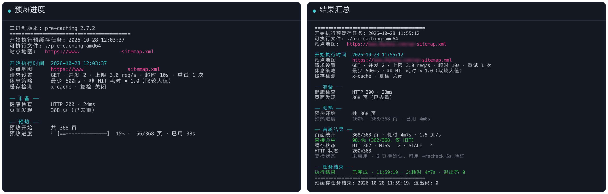

# pre-caching

Go 编写的网站预缓存工具，通过访问 sitemap 中的页面触发 CDN / 反向代理缓存，支持缓存状态检测、增量预热、预热后复检和 JSON 报告。部署支持 **Linux amd64 / arm64**。

## 运行预览



## 快速开始

### 1. 构建与部署

在已安装 Go 的开发机执行，按提示选择架构和版本号：

```bash
./release.sh

# 以 amd64 服务器为例，arm64 使用 pre-caching-arm64
scp dist/pre-caching-amd64 run_precache.sh precache.env.example user@server:/opt/pre-caching/
```

### 2. 配置站点

在服务器上执行：

```bash
cd /opt/pre-caching
chmod +x pre-caching-amd64 run_precache.sh
cp precache.env.example precache.env
vi precache.env
```

修改以下两项，其余配置可先用默认值：

```bash
SITEMAP_URL="https://www.example.com/sitemap.xml"
CACHE_HEADER="x-cache"  # Cloudflare 使用 cf-cache-status
```

更多配置见 [precache.env.example](precache.env.example)。配置优先级：**环境变量 > precache.env > 默认值**。

### 3. 运行

```bash
# 先试跑 10 页，确认网站响应和服务器负载正常
LIMIT=10 RECHECK=0 ./run_precache.sh

# 确认稳定后，按配置运行；默认处理全部页面
./run_precache.sh
```

默认单并发、最高 1 QPS，每次请求结束后至少休息 1 秒；非 HIT 请求还会按耗时延长休息。慢响应触发冷却，首次超时或连续慢响应 / 失败会中止任务。

> 单并发也可能给动态站带来压力，客户端超时后服务端可能仍在执行。触发保护时先查看日志、排查慢页面，再决定是否重跑。

## 常用方式

可直接运行二进制，也可以通过环境变量调整脚本配置：

```bash
# 直接预热
./pre-caching-amd64 -sitemap="https://www.example.com/sitemap.xml" -cacheheader="x-cache"

# 只预热最近 24 小时变更的页面；缺少 lastmod 的页面仍会请求
LASTMOD=24h ./run_precache.sh

# 预热后等待 1 分钟复检，并导出 JSON 报告
RECHECK=1m JSON_OUT=/opt/pre-caching/report.json ./run_precache.sh

# 排除指定路径（按 URL 子串匹配）
EXCLUDE="/user,/tags" ./run_precache.sh

# 查看全部参数与默认值
./pre-caching-amd64 -h
```

| 参数 | 默认值 | 用途 |
| --- | --- | --- |
| `-sitemap` | 必填 | sitemap 地址，支持索引和 gzip |
| `-cacheheader` | 空 | 缓存响应头；留空只统计 HTTP 状态码 |
| `-size` / `-rate` | `1` / `1` | 并发数 / 全局 QPS 上限 |
| `-delay` / `-rest-ratio` | `1000` / `1` | 请求后最小休息（毫秒）/ 非 HIT 按耗时休息的倍数 |
| `-timeout` / `-retry` | `10` / `1` | 请求超时（秒）/ 失败重试次数 |
| `-limit` / `-exclude` | `0` / 空 | 处理前 N 页（0 为全部）/ 排除 URL 子串 |
| `-lastmod` | `0` | 按最近修改时间筛选，如 `24h`；0 为全部 |
| `-recheck` | `0` | 预热后等待多久再复检，如 `1m`；0 为关闭 |
| `-json` | 空 | JSON 报告路径 |
| `-debug` | `false` | 显示详细诊断信息 |

## 如何查看结果

- **HIT**：本次请求直接命中缓存；首轮命中率不代表预热后的成功率。
- **MISS / EXPIRED 等**：本次未直接命中，是否成功写入缓存需开启 `RECHECK` 验证。复检命中率只代表待复检页面的结果。
- **DYNAMIC / BYPASS**：页面不可缓存，需检查 CDN 缓存规则。
- **缺少缓存头**：先确认 `CACHE_HEADER` 配置；可用 `curl -I https://你的域名/` 查看实际响应头。
- **慢页面**：默认列出耗时超过 2 秒的页面，超时始终列出；同一 URL 连续 3 个自然日超时后才自动加入 `slow-pages.txt`，后续运行自动排除。

默认日志为程序目录下的 `pre-cache.log`。日志每天或达到 5MiB 时轮转，最多保留一份 `.1` 备份；运行时清理超过 7 天的日志，不保证完整保留 7 天历史。需要完整请求结果时使用 JSON 报告。

| 退出码 | 含义 |
| --- | --- |
| `0` | 正常完成 |
| `1` | 健康检查、sitemap 获取或报告写入等失败 |
| `3` | 服务不可用率超过配置阈值 |
| `4` | 压力保护中止 |
| `130` | 被信号中断 |

## 定时任务

完成小批量验证后，用 `crontab -e` 添加所需任务，按实际部署路径修改：

```cron
SHELL=/bin/bash
PATH=/usr/local/bin:/usr/bin:/bin:/usr/sbin:/sbin

# 每小时第 5 分钟：增量预热
5 * * * * LASTMOD=2h /bin/bash /opt/pre-caching/run_precache.sh >> /opt/pre-caching/cron.log 2>&1

# 每天 03:10：全量预热并复检
10 3 * * * LASTMOD=0 RECHECK=1m /bin/bash /opt/pre-caching/run_precache.sh >> /opt/pre-caching/cron.log 2>&1
```

脚本自带防重叠执行锁。更多定时配置见 [crontab_example.txt](crontab_example.txt)。

## 升级与注意事项

- 站点配置写在 `precache.env`，避免升级脚本时丢失；升级后检查旧配置是否覆盖了新的默认值。
- 预热 CDN 时使用站点域名；`-host` 用于直连源站测试，不会预热 CDN。
- 默认使用 GET；部分 CDN 不会通过 HEAD 建立缓存。
- HTTPS 默认不校验证书，需要校验时在配置中设置 `VERIFY_SSL=1`。
- 遇到 403 / 429 / 503 时，检查 WAF 和限流规则，必要时为预热机 IP 配置白名单。
